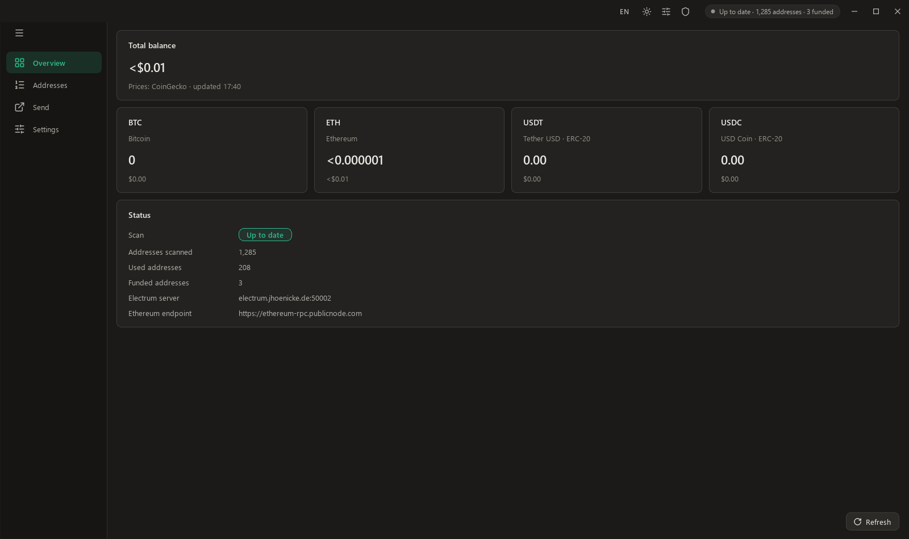
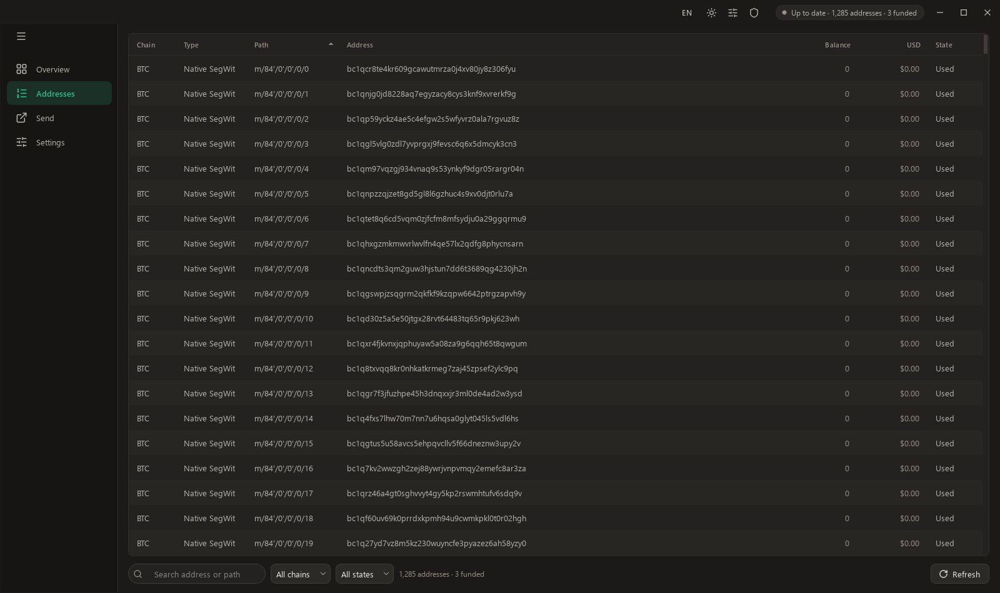

# GitWallet

A desktop wallet for Windows for businesses that take many payments on unique
addresses: **many seeds, every address of each one**, with per-address balances, a
total per wallet and one combined total in each coin and in USD. Built for seeds that
generate many addresses (e.g. a shop that makes a fresh address per order), where
ordinary wallets stop scanning after the first gap and miss funds further down.

> **Status: view-only, on Bitcoin and Ethereum (ETH, USDT, USDC).** Coins and networks
> are data now, what the wallets show is kept in an encrypted database, and a start
> shows it at once. Where it goes from here, with history, many more coins and spending,
> is in [docs/ROADMAP.md](docs/ROADMAP.md). Spending is tested on test networks before it
> touches real funds.





## What it does

1. **View** *(done)* — add as many named wallets as you need, up to 500: a BIP39
   seed once, or just its public keys (zpub, ypub, xpub) when the seed should
   never touch this PC. **One at a time or a whole list:** *Add many* takes one seed
   or one set of public keys per line, pasted or from a text or CSV file, each with
   a name if you want (`Shop 1: word word ...`, `"Shop 2","word word ..."`, a
   numbered list). The good lines go in together; what did not go in stays in the
   field, each line named by its number with the reason and never quoted. A line goes
   in only when it has one reading: a stray comma inside a phrase, a name that could
   be part of the phrase, a seed already here and a name in use are refused, as a
   checksum alone passes by chance too often. Seed words or a private key are never
   taken as a name. A line of public keys can hold a whole wallet: its second xpub is
   read as the Ethereum account. GitWallet derives the account public keys and scans every
   Bitcoin address type (native SegWit, nested SegWit, legacy — receive and
   change) and Ethereum (ETH, USDT, USDC) far past the last used address (gap
   limits are configurable, default 200 / 50 / 100). Taproot and accounts other than
   the first are not scanned yet, and the Add dialog says so. The Wallets page lists what
   each wallet holds; each address shows its wallet, balance and state, can be
   filtered by wallet, chain and state, and what the filters leave exports to
   CSV for the books; the Overview shows the totals in each coin and in USD, with
   where the prices come from and how old they are. Addresses another app creates
   later from the same seed appear by themselves.
2. **Send BTC** *(next)* — sweep selected or all addresses into one transaction.
3. **Sweep ETH + tokens** *(after that)* — empty each account in turn (Ethereum
   needs one transaction per address; gas is funded automatically for tokens).

**Size.** 500 wallets at the default gaps are 425,000 addresses. Everything fits a
connection's live places on a small wallet, so nothing changes there. Past 40,000
Bitcoin addresses, the next unused addresses of each chain stay followed live, and up to
10,000 of those holding coins; the rest are read again and again in long rounds, about 30
minutes at that size, and Refresh starts one if none is under way; the Overview says how
long, and says so if a round fails or runs far past that. An address a server refuses to
follow is read the same way, and a server that refuses everything is left for the next. On
Ethereum, a pass that takes longer than the refresh lets the next unused addresses and those
holding a balance go first, every refresh. What was measured to get there is in
[docs/ENDPOINTS.md](docs/ENDPOINTS.md).

A plain `xpub` does not say what it is, because wallets write SegWit accounts with
that prefix too, so GitWallet asks and shows the first address of each key to
compare with the other wallet.

## What is stored

- `wallet.dat`, encrypted for the current Windows user with DPAPI: each wallet's name
  and **account-level public keys** (zpub / ypub / xpub at `m/84'/0'/0'`, `m/49'/0'/0'`,
  `m/44'/0'/0'`, `m/44'/60'/0'`, or those you pasted), the scan settings and the key
  of the database below. A seed is used once to derive those keys and is then scrubbed
  from memory; it is never written anywhere. Public keys can show balances but cannot
  spend. A `wallet.dat` from an earlier version loads as it was, and a copy stays beside it
  as `wallet.dat.format<N>-<date>`, since that version cannot read what is written next.
- `wallet.db`, encrypted with SQLCipher under a random key only `wallet.dat` holds: every
  address with what it last showed, and the prices with their times. A start reads it
  first and shows it marked as saved until the servers have answered. Every page is checked
  at the start; one that fails moves the file aside and a new one is made. It is a copy:
  deleting it only means the next start reads everything again.

Starting GitWallet again brings the open window to the front instead of opening a
second one, and only one window at a time writes these files. A CSV export is not
encrypted: anyone who reads it sees those addresses and balances.

If `wallet.dat` cannot be read (another Windows user's, damaged, from a newer
GitWallet), it is never overwritten: adding a wallet keeps it beside the new file as
`wallet.dat.unread-<date>-<time>` and says so, and the database under its key is kept
the same way. "Remove all wallets" deletes those too.

## Coins and networks

All of it is data, in `res/coins.json`: each network's family, servers, explorer links,
address format, coin and tokens, with the names each price source knows them by. A
network of a family GitWallet has code for is one entry there, with no code: the scanners,
the pages, the prices, the settings and the database follow. Every build tests that with a
network added from a file, for its rows, totals and prices. An Ethereum-style address is one row per network, as what it
holds and whether it answered differ per network.

## Network

- **Bitcoin:** Electrum protocol over TLS to public servers whose certificates
  verify against the Windows CA store (self-signed servers are not used); one
  server at a time, automatic failover, live subscriptions. A server has to show Bitcoin's
  first block, so one on another chain is never asked about an address.
- **Ethereum:** public JSON-RPC endpoints (no API key), one Multicall3
  `eth_call` per up to 600 addresses for every balance, failover between endpoints, and
  each endpoint asked at the pace it was measured to keep answering. Nonces cost public
  endpoints far more than balances, so they are read for new addresses and otherwise once
  an hour or so, or at every start up to 10,000 addresses. Past that a reading goes on where
  it stopped, also in the next run, so a wallet opened for a few minutes at a time still
  gets through them. An address stays used once it held something, as one swept by signature
  keeps its nonce at 0; changing the endpoints in Settings reads everything anew, in case
  that was an endpoint's word.
- **Prices:** [DefiLlama](https://defillama.com/) first, as it answers by contract and says
  how old each price is, then CoinGecko and Coinbase for what it does not answer, answers
  with a price over an hour old or is not sure of. A price stays until a newer one replaces
  it, and says when it is from. One source alone does not decide what looks wrong (a dollar
  coin far from a dollar, ten times what was held a moment ago): that takes a second source
  agreeing, and a first price is confirmed by the next source that can be asked.

Servers and endpoints can be replaced in Settings, per network.

## Design

The window, title bar, sidebar, tables and theming are the **FlowSuite v3
design system** (C++/Qt 6 Widgets), reused here so GitWallet matches the rest of
the suite. Only the look-and-feel layer was reused; all wallet logic is new
(`src/chain`, `src/net`, `src/wallet`, `src/store`, `src/app`, `src/ui/pages`).

## Cryptography

- **BIP39 / BIP32 / BIP44 / BIP49 / BIP84** derivation, watch-only from each
  wallet's stored account keys.
- [libsecp256k1](https://github.com/bitcoin-core/secp256k1) (Bitcoin Core's
  library) for elliptic-curve operations.
- [Botan](https://botan.randombit.net/) for SHA-256/512, RIPEMD-160,
  HMAC-SHA512, PBKDF2, Keccak-256 and big-integer amounts.
- [SQLCipher](https://www.zetetic.net/sqlcipher/) for the database: AES-256 pages, each
  with its own authentication code.

## Verification

Every claim below is reproducible with the public BIP39 test mnemonic
(`abandon … about`) in a throw-away data folder:

| Check | Result |
|---|---|
| `GitWallet --selftest` — BIP39, BIP32 (TV1 incl. xpubs), BIP84 (zpub + addresses), public == private derivation, Ethereum, amounts; the list of coins loads | 21 / 21 |
| Bitcoin addresses vs **Electrum 4.8.3** watch-only wallets from the same zpub / ypub / xpub (receive + change, all three types) | 90 / 90 identical |
| Every Bitcoin address's history and balance vs **Blockstream's electrs** server (a different operator and implementation than the scan used) + a mempool.space sample | 988 / 988 identical |
| Every Ethereum address's nonce, ETH, USDT and USDC vs a **different RPC node**, with plain calls instead of Multicall | 297 / 297 identical |
| `--walkthrough`: the real UI driven like a user — a seed with three kinds of mistakes, a second seed, the same seed refused, public keys, totals per wallet adding up, filter, CSV, rename, settings, close and reopen with the figures there at once and marked as saved, remove one, a list of seeds and of public keys from a file and a paste, remove all | run on every push (see below) |
| `--store-test`: every `wallet.dat` format, ids, repeated keys, public-key parsing, reading lists, adding in a batch, per-wallet totals against 4,000 random changes, the database (every field back as written, nothing readable without its key, another key refused, a wallet removed staying gone), the price sources against a local server (one failing, all failing, one behind, one that makes no sense), 425,000 addresses written in any order, read and into the model, and both scanners against servers on the same PC that refuse, lie, answer for another chain, cap a batch or go away, offline | run on every push (see below) |
| `--scale-test 425000`: the real window with that many rows: chunks, sorting, searching, filtering and exporting, each timed, with what it shows checked against the rows | run on every push (see below) |
| `.github/compare-scans.ps1`, live: a scan read in rounds gives every address the same status and balance as one followed live; one more network from a file has its rows, its prices and the same address | run on every push (see below) |

The address and balance comparisons with other software were made on the single-seed view;
the address derivation they cover is unchanged. Every push to `main` or `multi-seed` builds
GitWallet on a clean Windows machine and runs the self-test, the store test, the window at
scale, the walkthrough and the comparison of scans there (`.github/workflows/build.yml`), since
Windows Defender may quarantine an unsigned local build.

Test-only switches (they refuse to run without `--data-dir`, so they never touch
the real wallet):

```bat
GitWallet --selftest
GitWallet --data-dir C:\tmp\gw --import-test-mnemonic --scan-report report.json
GitWallet --data-dir C:\tmp\gw2 --walkthrough C:\tmp\walk
GitWallet --data-dir C:\tmp\gw3 --store-test
GitWallet --data-dir C:\tmp\gw4 --demo-wallets
GitWallet --data-dir C:\tmp\gw5 --coins-file coins.json --import-test-mnemonic
GitWallet --data-dir C:\tmp\gw6 --live-places 10 --import-test-mnemonic --scan-report report.json
```

`--demo-wallets` fills the folder with published test seeds, to see the app with real
addresses and balances. Anyone can spend from those seeds: never send anything to them.

## Build

Requirements: Visual Studio 2022 (MSVC x64), Qt 6.10.3 at
`C:\Qt\6.10.3\msvc2022_64`, CMake + Ninja, and vcpkg at `C:\app-vcpkg`.

```bat
build.bat
```

This configures with the vcpkg toolchain (Botan, zlib, secp256k1, SQLCipher), builds
`build\GitWallet.exe` with Qt beside it and deploys a copy to `dist\` (the exe, Qt
and the Visual C++ runtime, with the Qt plugins in `dist\lib\plugins`). Start
`dist\GitWallet.exe`; the `dist` folder can be copied anywhere. Builds are not signed
yet, so a PC with Smart App Control on blocks them, and Windows Defender may flag a
new build.

## Security

- A seed never leaves the machine and is never written to disk.
- Servers see the addresses they are asked about (Bitcoin scripthashes, Ethereum
  addresses) and this PC's IP: a server can tell they belong together. With a
  connection to one Electrum server at a time, that server sees them all.
- Answers are not proven yet: a server could lie about a balance. Checking proofs for
  Bitcoin and a second endpoint for Ethereum come with the transaction history.
- TLS / HTTPS certificate verification is always on.
- Spending features will be tested on Bitcoin testnet and Ethereum Sepolia
  before release; real transfers are always initiated by you.

## License

MIT — see [LICENSE](LICENSE). Icons: [Lucide](https://lucide.dev) (ISC).
