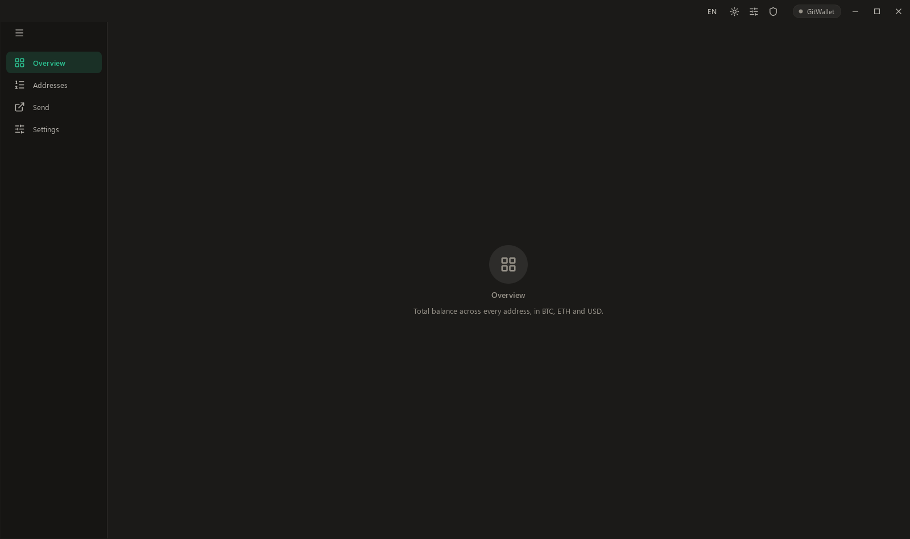

# GitWallet

A desktop wallet for Windows that shows **every address derived from one seed**
— across Bitcoin and Ethereum — with per-address balances and one combined
total in BTC, ETH and USD. Built for seeds that generate many addresses (e.g. a
shop that makes a fresh address per order), where ordinary wallets stop scanning
after the first gap and miss funds further down.

> **Status: in development.** Stage 1 (view-only: seed → all addresses →
> balances) is being built first. Spending is added only afterwards and is
> tested on test networks before it touches real funds.



## What it does (planned, by stage)

1. **View** — enter a seed, see every BTC and ETH address it generates (large
   gap limit), each balance, and the grand total in BTC / ETH / USD. New
   addresses appear automatically.
2. **Send BTC** — sweep selected or all addresses into one transaction.
3. **Sweep ETH + tokens** — empty each account in turn (Ethereum needs one
   transaction per address; gas is funded automatically for token sweeps).

## Design

The window, title bar, sidebar, tables and theming are the **FlowSuite v3
design system** (C++/Qt 6 Widgets), reused here so GitWallet matches the rest of
the suite. Only the look-and-feel layer was reused; all wallet logic is new and
lives under `src/chain/`.

## Cryptography

- **BIP39 / BIP32 / BIP44 / BIP49 / BIP84** derivation.
- [libsecp256k1](https://github.com/bitcoin-core/secp256k1) (Bitcoin Core's
  library) for elliptic-curve operations.
- [Botan](https://botan.randombit.net/) for SHA-256/512, RIPEMD-160,
  HMAC-SHA512, PBKDF2 and Keccak-256.
- Address derivation is checked at every startup against published test vectors
  (BIP32, BIP84 and the standard Ethereum test mnemonic); run them explicitly
  with `GitWallet --selftest`.

## Build

Requirements: Visual Studio 2022 (MSVC x64), Qt 6.10.3 at
`C:\Qt\6.10.3\msvc2022_64`, CMake + Ninja, and vcpkg at `C:\app-vcpkg`.

```bat
build.bat
```

This configures with the vcpkg toolchain (Botan, zlib, secp256k1) and produces
`build\GitWallet.exe`.

## Security

- Your seed and keys never leave the machine and are never written in clear.
- Nothing is sent to any server except balance lookups (Electrum servers for
  Bitcoin, public Ethereum RPC) by address.
- Spending features are tested on Bitcoin testnet and Ethereum Sepolia before
  release; real transfers are always initiated by you.

## License

MIT — see [LICENSE](LICENSE).
